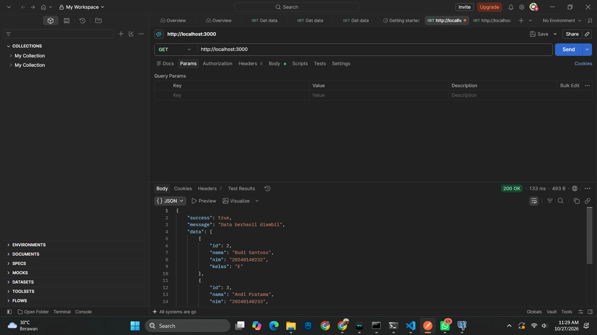
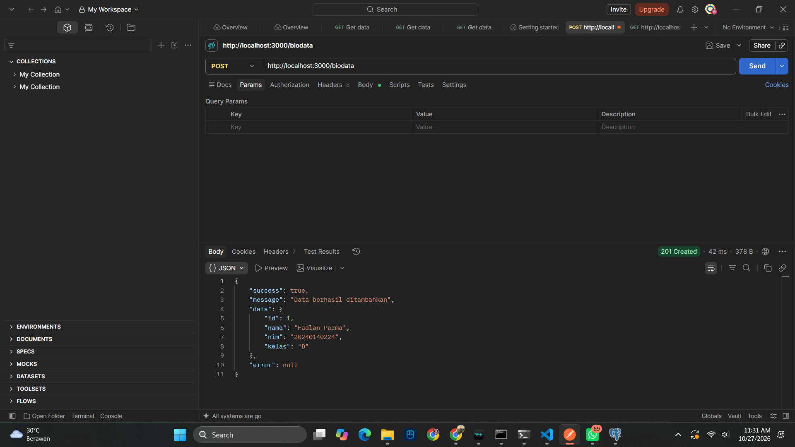
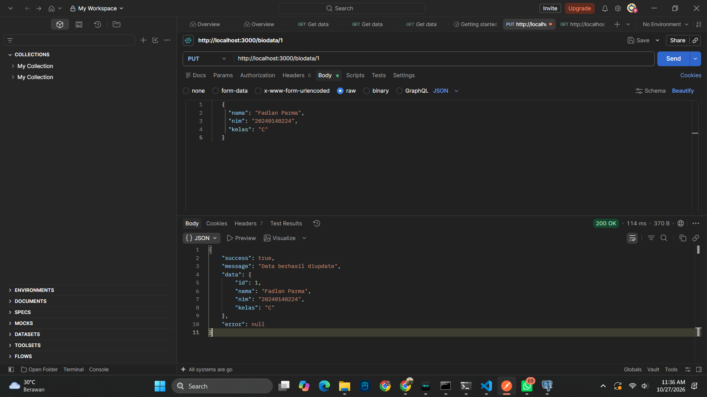
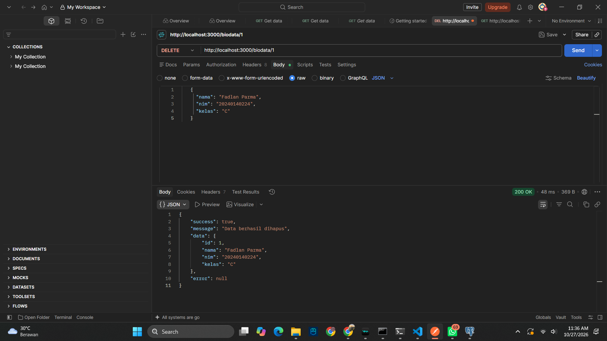

## 📸 Dokumen Hasil Pengujian (Screenshots)

Berikut adalah bukti pengujian endpoint API menggunakan middleware:

### 1. Request GET

### 2. Request POST

### 3. Request PUT

### 4. Request DELETE

